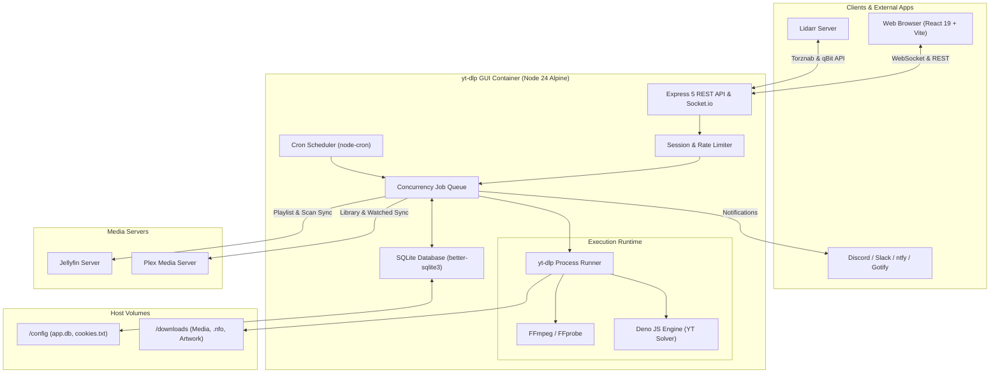
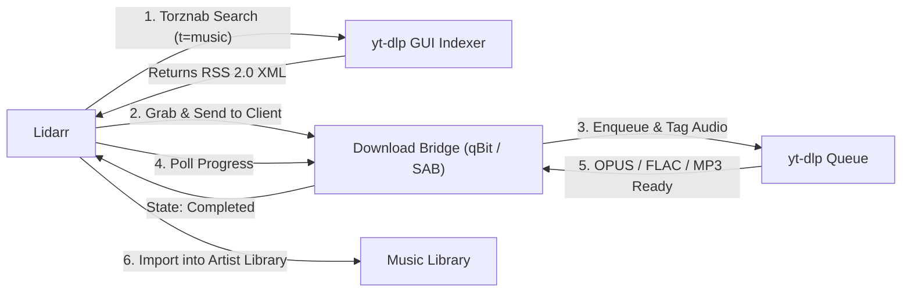

<p align="center">
  <a href="#yt-dlp-gui">
    
  </a>
</p>

<p align="center">
  <a href="https://github.com/rpeters1430/yt-dlp-gui/actions/workflows/docker-publish.yml"></a>
  
  
  
  
  
  
</p>

<p align="center">
  A self-hosted web app for downloading video and audio from <b>any site <a href="https://github.com/yt-dlp/yt-dlp">yt-dlp</a> supports</b> — YouTube, Vimeo, Twitter/X, TikTok, Reddit, SoundCloud, Twitch, Bandcamp, and hundreds more.
  <br>
  Paste URLs, monitor real-time WebSocket progress, manage an in-browser media library, record live streams, organize high-fidelity music releases, and automatically follow channel uploads and playlists.
</p>

<p align="center">
  <a href="#quick-start-docker-compose"><b>🚀 Quick Start</b></a> •
  <a href="#project-status--roadmap"><b>📊 Project Status</b></a> •
  <a href="#features"><b>✨ Features</b></a> •
  <a href="#music-hub--lidarr-integration"><b>🎵 Music & Lidarr</b></a> •
  <a href="#live-streams--twitch-hub"><b>🔴 Live Streams</b></a> •
  <a href="#architecture"><b>🏗️ Architecture</b></a> •
  <a href="#configuration"><b>⚙️ Config</b></a>
</p>

---

<p align="center">
  
</p>

---

## 📊 Project Status & Roadmap

> [!NOTE]
> **Current Release:** `v1.0.0` (Active Production & Feature Development)  
> Container image builds are automatically published to GitHub Container Registry (`ghcr.io/rpeters1430/yt-dlp-gui:latest`) on every merge to `main`.

Each GitHub Actions image build checks the official upstream releases for the
latest **yt-dlp nightly** and **FFmpeg autobuild**. It resolves both tools once,
uses the same versions for amd64 and arm64, and verifies their SHA256 hashes.
New versions invalidate the relevant Docker layers automatically. Runtime smoke
tests and vulnerability scans must pass before the image is published.

The Actions summary records the selected releases. Their URLs and checksums are
also saved inside the image at
`/usr/local/share/yt-dlp-gui/tool-versions.json`. Existing tools stored in your
`/config` volume can still take precedence according to the app's settings.

For a local build that checks upstream again even when Docker layers are cached:

```bash
docker buildx build --no-cache-filter tool-versions --load -t yt-dlp-gui:local .
# Or refresh all layers when building with Compose:
docker compose build --no-cache
```

This checks for tool updates whenever an image is built; it does not schedule
additional image builds. The app's existing overnight tool updates still apply.

### Component Status Matrix

| Module | Status | Highlights |
|---|---|---|
| **Core Queue & Downloader** | 🟢 Production Ready | Concurrent queue, watchdog timers, delta socket logs, audio drift correction |
| **Music Hub & Audio Engine** | 🟢 Production Ready | OPUS bitstream copy (~160kbps), 320k MP3, M4A, FLAC, auto-tagging & cover art |
| **Lidarr Torznab & Download Bridge** | 🟢 Production Ready | Torznab indexer (`/api/lidarr/torznab`), qBit/SAB emulation, missing album browser, auto-import sync |
| **Watches (Channel Feeds)** | 🟢 Production Ready | Multi-tab discovery (Videos, Shorts, Live), baseline checks, regex filtering, retry backoff |
| **Live Stream Recorder** | 🟢 Production Ready | YouTube, Twitch, TikTok Live, MPEG-TS HLS chunking, graceful finalization, manual split |
| **Library & Streaming Player** | 🟢 Production Ready | In-browser seeking with HTTP range requests, `.nfo` & poster generation, file protector |
| **Media Server Integration** | 🟢 Production Ready | Jellyfin playlist sync & watched status, Plex library scans & watched auto-delete |
| **Test & Code Quality** | 🟢 212+ Tests Passing | ESLint clean across client and server, modular Express app (`src/app.js`), lazy-loaded client routes |

### Recent Milestones & Improvements
- **🎵 Full Lidarr Integration**:
  - Implemented Torznab RSS 2.0 indexer (`t=caps`, `t=music`, `t=search`) with audio categories (`3000`, `3010`, `3020`, `3040`).
  - Added qBittorrent v2 and SABnzbd Web API emulation with deterministic infohashes and on-demand `.torrent` generation.
  - Direct UI browsing of Lidarr **Wanted / Missing Albums** with one-click queueing and automated `DownloadedAlbumsScan` triggers.
  - Configurable download paths and cross-platform Docker path normalization.
- **🔴 Resilient Live Stream Handling**:
  - Automatically recognizes when streams finish and gracefully completes finalization without killing active remux processes.
  - User-directed chunk splitting when manually stopping live recordings.
  - Real-time elapsed time counter and pulsing indicator for active streams.
- **⚡ Performance & Socket Optimization**:
  - Progress updates stream full logs only on delta changes (≤1/s per job), drastically reducing network chatter.
  - Server-side history searching, status filtering, and pagination.
  - Client-side code splitting with lazy-loaded page routes (initial JS bundle trimmed down to 393 kB).
- **🔊 Audio & Remux Fixes**:
  - Resolved audio sync drift on variable-framerate streams and complex multi-stream remuxes.
- **🧪 Test Suite & Refactor**:
  - Expanded test suite from 146 to 212+ automated tests covering queue lifecycle, mock yt-dlp execution, auto-delete, sessions, and notification delivery.
  - Modularized `ytdlp.js` into focused modules (`ytdlpPaths.js`, `ytdlpCookies.js`, `ytdlpTools.js`).

### Active Backlog & Next Up
- [ ] Non-Watch failed download retry button (`POST /api/downloads/:id/retry`) and bulk queue actions ("Retry all", "Clear completed").
- [ ] Pause / resume and drag-and-drop queue reordering.
- [ ] Dynamic concurrency control adjustable directly in the Settings UI without restart.
- [ ] Automatic duplicate detection for re-submitted video URLs or IDs.
- [ ] Vitest + React Testing Library frontend test suite.
- [ ] Ultra-compact phone layout audit for 360px–400px viewports.

---

## Contents

- [Features](#features)
  - [Downloading & Queue](#downloading)
  - [Library & Browser Player](#library)
  - [Watches (Auto-download Feeds)](#watches-auto-download-new-uploads)
  - [Auto-delete & Housekeeping](#auto-delete)
  - [Live Streams & Twitch Hub](#live-streams)
  - [Music Hub & Lidarr Integration](#music-hub--music-watcher)
  - [Link Grabber & Forum Crawler](#link-grabber--forum-crawler)
  - [Notifications](#notifications)
  - [Media Server Sync (Jellyfin & Plex)](#jellyfin-playlist-sync)
- [Quick start (Docker Compose)](#quick-start-docker-compose)
- [Updating](#updating)
- [Configuration](#configuration)
- [File naming](#file-naming)
- [Notifications](#notifications)
- [Site cookies](#site-cookies-youtube-twitch-and-others)
- [Jellyfin integration](#jellyfin-integration)
- [Plex integration](#plex-integration)
- [Lidarr integration](#lidarr-integration)
- [Link Grabber & forum crawler](#link-grabber-and-forum-crawler)
- [Scheduled tasks](#scheduled-tasks)
- [Where your data lives](#where-your-data-lives)
- [Security notes](#security-notes)
- [Troubleshooting](#troubleshooting)
- [Local development](#local-development-without-docker)
- [Architecture](#architecture)
- [Automatic image builds](#automatic-image-builds)

---

## Features

### Downloading
- Paste one or many URLs at once; jobs are queued with configurable concurrency
- Pause or resume the queue, move a queued download to the front, and prioritize manual downloads ahead of Watch backfills
- Live progress bars over WebSocket (percent, speed, ETA)
- Format picker, audio-only (MP3), timestamp/chapter trimming, subtitles, embedded thumbnail/metadata/chapters, and SponsorBlock auto-remove
- Optional per-download bandwidth caps and jittered delays to reduce network saturation and rate limits
- Download history with thumbnails, file paths, and the exact yt-dlp command and log for every job
- Customizable filename/folder layout — pick a preset or write your own yt-dlp template, globally or per Watch (see [File naming](#file-naming))
- Writes a Kodi/Jellyfin/Emby-compatible `.nfo` + poster image next to every download so titles, descriptions, and artwork scrape reliably (toggle in Settings)

### Library
- **In-browser media center**: Browse all downloaded media in a responsive grid with instant search, category filters, and sorting.
- **Direct browser playback**: Stream video and audio files directly in the browser with seeking (HTTP range requests) — no external media server needed.
- **File management**: One-click local device download, file deletion protection, or clean removal (including accompanying `.nfo`, subtitles, and posters).
- **Health tracking**: Automatically detects files moved or deleted outside the application.

### Watches (Auto-download new uploads)
- **Automated polling**: Point a Watch at a playlist or channel URL; it automatically checks for new uploads on a schedule (default: 30 minutes).
- **Channel tab support**: YouTube channel URLs (`youtube.com/@name`) can individually track **Videos**, **Shorts**, and **Live streams**.
- **Smart baselines**: Discovered videos are baselined on creation so you aren't flooded with old uploads, with optional backfill of the latest $N$ uploads (or all existing up to 5,000).
- **Regex title filters**: Include and exclude regular expression matching with in-browser regex testing before saving.
- **Automatic retry with exponential backoff**: Failed items retry up to four times (15m, 1h, 6h) before pausing.
- **Audit ledger**: Comprehensive **Activity** tab displaying the exact scan history and disposition of every cataloged video.

### Auto-delete
- Optionally clean up Watch-downloaded videos: delete after N days, once watched in Jellyfin, or both
- Runs nightly, with a dry-run preview and a "run now" button
- Safety guards: per-video protect, per-Watch exemption, and "always keep newest N"
- Optional free-space guard: run cleanup and pause new Watch queueing below a configured disk threshold

### Queue and failure recovery
- Pause queued work while active downloads finish; resume whenever you're ready
- Promote a queued download to the front of the queue
- Filter failed jobs by likely cause (network, bot check, authentication, or unavailable) and retry only matching or transient failures

### Mobile sharing
- Install the app on a supported Android browser and share links to it from other apps, or use the bookmarklet in Settings → Downloads

### Live streams
- **YouTube and any other yt-dlp live extractor** — a URL that's currently live is detected automatically in the Analyze modal
- Join at the live edge, or record the whole broadcast from the start (`--live-from-start`)
- Scheduled streams that haven't started yet can be waited on and recorded the moment they go live (`--wait-for-video`)
- **TikTok Live** — paste a `tiktok.com/@user/live` link; if they're offline, queue **Wait & Auto-Record** and recording starts the next time they go live (also works for offline Twitch channels)
- Recordings use MPEG-TS-safe HLS segments (`--hls-use-mpegts`), so the file stays playable even if interrupted
- Live jobs show a pulsing **LIVE** badge and elapsed time, with a one-click **Stop Recording** that keeps everything captured so far

### Twitch hub
- Record a live channel, including auto-record when it goes live
- Browse and download a channel's VODs
- Trim a VOD or clip to a time range
- Track active recordings in real time

### Music Hub & Music Watcher
- Search and discover albums, artists, and tracks with high-resolution artwork and 30-second audio previews.
- Auto-match YouTube audio streams and transcode to **OPUS** (highest quality native bitstream copy, ~160 kbps VBR), **MP3** (up to 320 kbps CBR), **M4A (AAC)**, or **FLAC**.
- Full ID3/Vorbis metadata embedding with track numbers and cover art.
- Structured filesystem layout: `{MusicFolder}/{Artist}/{Album}/{TrackNumber} - {Title}.{ext}`.
- Dedicated Music Watches to track artist releases and discographies.

### Lidarr Integration
- **Torznab Indexer (`/api/lidarr/torznab`)**: Emulates a Torznab RSS indexer with full music categories and deterministic torrent infohashes.
- **Download Client Bridge (`/api/lidarr/qbit` & `/api/lidarr/sab`)**: Emulates qBittorrent v2 or SABnzbd API endpoints for seamless handoff to Lidarr's Completed Download Handling.
- **Wanted Albums Browser**: Direct UI interface within the Music page to browse Lidarr's wanted missing albums and grab them with one click.
- **Automatic Library Rescan**: Automatically commands Lidarr to run `DownloadedAlbumsScan` upon job completion.

### Link Grabber & Forum Crawler
- **Links page**: Crawl a forum thread or any page and list every download link it contains, grouped by host, with filters and search.
- **Thread-aware**: XenForo threads (SimpCity and similar) can be crawled whole, by page range, or just the last N pages; quoted replies and mirror-bot reposts are skipped and Base64-hidden links decoded.
- **Post by post**: Each link shows who posted it and links back to the post; group the list by post, and see the archive password given in that post.
- **Background crawls**: A crawl runs on the server with live progress and a Cancel button, and the last 50 are kept under **Recent crawls** to reopen.
- **Link checks**: See whether links still work before sending them, with file name and size from Pixeldrain, MEGA and direct file links.
- **Thread watches**: Re-crawl a thread's newest pages on a schedule and send the links you haven't had yet to JDownloader, the queue or aria2, with a notification.
- **Your choice of hand-off**: Copy the selected links, queue them here with yt-dlp, or send them to JDownloader (Click'n'Load) or aria2. Nothing is sent until you click **Send**.
- **History**: Links you've already sent or copied are marked, even through a host's mirror domains (bunkr.si and bunkr.fi count as one), so re-crawling an active thread highlights only what's new.
- **Command-line crawler** (`crawler/`): The same crawl from a terminal through the app, printing a plain list of links to copy (see [below](#link-grabber-and-forum-crawler)).

### Notifications
- Dispatches webhook payloads to **Discord**, **Slack**, **Mattermost**, **Rocket.Chat**, **ntfy**, **Gotify**, or generic JSON webhooks (Home Assistant, n8n, Node-RED).
- Configurable event subscriptions: download completed, download failed, Watch queued new items, or Watch check failures.

### Jellyfin & Plex Integration
- **Jellyfin**: Automated per-Watch playlist creation and synchronization, and "Watched in Jellyfin" auto-delete triggers.
- **Plex**: Post-download library scan commands, per-Watch playlist sync, and token-scoped "Watched in Plex" auto-delete.

### Maintenance & Security
- Bundles self-managed static builds of [yt-dlp](https://github.com/yt-dlp/yt-dlp), [FFmpeg](https://github.com/yt-dlp/FFmpeg-Builds), and [Deno](https://deno.com) (for YouTube challenge solving).
- Toggle between yt-dlp **Stable** and **Nightly** channels with automated overnight update checks.
- Rate-limited single admin authentication with session invalidation on credential rotation.
- Built-in SSRF protection blocking loopback and private IP targeting by default.

---

## System Architecture



### Maintenance & security
- Bundles modern static FFmpeg builds from [yt-dlp/FFmpeg-Builds](https://github.com/yt-dlp/FFmpeg-Builds) and the [QuickJS-ng](https://github.com/quickjs-ng/quickjs) JavaScript runtime yt-dlp needs for YouTube, with FFmpeg checksum and QuickJS binary validation before installation
- Choose the yt-dlp **stable** or **nightly** channel; the choice survives container recreation
- Single admin login with rate-limited login attempts and session invalidation on password change; Lidarr API-key endpoints are rate-limited too
- Cookie support for any site, for age-restricted, members-only, private, or subscriber-only content
- Blocks URLs that target private/loopback addresses, including hostnames resolving to private IPs (SSRF guard)
- Optional `PUID` / `PGID` support for NAS file ownership

## Quick start (Docker Compose)

Prebuilt multi-arch images (`linux/amd64` and `linux/arm64`) are automatically pushed to GitHub Container Registry. No local compiling required.

### 1. Create directory structure

```bash
mkdir -p ytdlp-gui/downloads ytdlp-gui/videos ytdlp-gui/music ytdlp-gui/config
cd ytdlp-gui
```

### 2. Create `docker-compose.yml`

```yaml
services:
  ytdlp-gui:
    image: ghcr.io/rpeters1430/yt-dlp-gui:latest
    container_name: ytdlp-gui
    restart: unless-stopped
    ports:
      - "3000:3000"
    env_file:
      - .env
    environment:
      - MAX_CONCURRENT_DOWNLOADS=2
      - TZ=America/Los_Angeles
      # Optional: use your NAS user and group IDs (check with `id`)
      # - PUID=1000
      # - PGID=10
      - VIDEO_DIR=/videos
      - MUSIC_DIR=/music
    volumes:
      - ./downloads:/downloads
      - ./videos:/videos
      - ./music:/music
      - ./config:/config
```

Adjust to taste:
- **`./videos` / `./music`** — point these at your media library folders (e.g. `/volume1/Media/YouTube:/videos`, `/volume1/Media/music:/music`). Videos are saved under `VIDEO_DIR`, music under `MUSIC_DIR`. Leave both variables and mounts out to keep everything in `./downloads`.
- **`ports`** — change the left-hand `3000` if that port is taken (e.g. `"8080:3000"`).
- **`TZ`** — your timezone (e.g. `America/New_York`), so scheduled checks and timestamps line up.
- **`MAX_CONCURRENT_DOWNLOADS`** — keep this low (1–2) on a NAS with limited CPU.
- **`PUID` / `PGID`** — optional host UID and GID for the app process and files it creates. When set, the container adjusts `/config` ownership and the top level of download directories before dropping root privileges.

### 3. Create `.env` next to it

```env
ADMIN_USER=admin
ADMIN_PASSWORD=choose-a-strong-password
```

> [!TIP]
> - If `ADMIN_PASSWORD` is omitted, a random password is generated on first launch and printed once to the container logs (`docker compose logs ytdlp-gui`).
> - Secure this file: run `chmod 600 .env` on Linux servers.

### 4. Start the container

```bash
docker compose pull
docker compose up -d
```

Access the web interface at `http://<your-server-ip>:3000`.

yt-dlp, FFmpeg, and QuickJS-ng can also be updated from **Settings** without pulling a new image, and are checked automatically overnight (see [Scheduled tasks](#scheduled-tasks)). If you'd rather have a reproducible yt-dlp version, pin it in the `Dockerfile` (`pip3 install yt-dlp==<version>`) and build locally — see [PyPI](https://pypi.org/project/yt-dlp/) for release history.

## Configuration

All configuration variables can be passed via `.env` or the `environment:` block in `docker-compose.yml`.

### Core Settings

| Variable | Default | Description |
|---|---|---|
| `ADMIN_USER` | `admin` | Login username. |
| `ADMIN_PASSWORD` | random (printed once) | Login password. |
| `SESSION_SECRET` | generated & persisted | Secret used to sign session cookies. |
| `PUID` | `0` (root) | Optional numeric user ID for the app and download processes inside Docker. |
| `PGID` | `0` (root) | Optional numeric group ID for the app and download processes inside Docker. |
| `TZ` | container default (UTC) | Timezone for schedules and timestamps. |
| `PORT` | `3000` | Port the server listens on inside the container. |
| `MAX_CONCURRENT_DOWNLOADS` | `2` | How many downloads run at once. |
| `CONCURRENT_FRAGMENTS` | `4` | Fragments fetched in parallel within one HLS/DASH download (Twitch VODs and most non-YouTube sites). `1` turns it off; live recordings never use it. |
| `FORCE_KEYFRAMES_AT_CUTS` | off | Set to `1` to pass `--force-keyframes-at-cuts` when SponsorBlock or a section download cuts the file. Cleaner cuts, but yt-dlp re-encodes the entire video in software, which can pin every CPU core for a long time. |
| `JS_RUNTIMES` | `deno,node,quickjs` | JS runtimes yt-dlp may use for YouTube challenge solving, comma-separated. Ones that aren't installed are skipped, and yt-dlp prefers Deno, then Node, then QuickJS-ng. |
| `TRUST_PROXY` | off | Set to `1` behind a TLS-terminating reverse proxy — required for `COOKIE_SECURE` to work there. |
| `COOKIE_SECURE` | off | Set to `1` once the app is reachable over HTTPS; restricts the login cookie to HTTPS. |
| `ALLOW_LOCAL_URLS` | off | Set to `1` to allow URLs pointing at loopback/private/link-local addresses (e.g. `127.0.0.1`, `192.168.x.x`). Only needed to target an internal mirror or service. |

### Timeouts & watchdogs

| Variable | Default | Purpose |
|---|---|---|
| `DOWNLOAD_IDLE_TIMEOUT_MS` | `900000` (15 min) | Stops a download if yt-dlp produces no output this long, so a hung job can't hold a queue slot forever. Not applied to "wait for stream to go live" jobs. |
| `LIVE_DOWNLOAD_IDLE_TIMEOUT_MS` | `3600000` (60 min) | Same watchdog for active live recordings, which can legitimately stay quiet longer. |
| `PLAYLIST_DOWNLOAD_IDLE_TIMEOUT_MS` | `3600000` (60 min) | Same watchdog for playlist URLs (e.g. `...?list=...`), which may spend a long time preparing before the first progress line. |
| `DOWNLOAD_MAX_QUIET_MS` | `14400000` (4 h) | When the watchdog fires but the job is still using CPU (e.g. FFmpeg merging a multi-hour capture), it's spared — up to this hard cap of total silence. |
| `GETINFO_TIMEOUT_MS` | `120000` (2 min) | Timeout for metadata-only lookups (format picker, Watch checks, pre-download info). |

### Binaries & update schedules

| Variable | Default | Purpose |
|---|---|---|
| `YTDLP_BIN` | `yt-dlp` | Path to the yt-dlp binary, if not on `PATH`. |
| `FFMPEG_DIR` | auto-detected | Directory containing `ffmpeg`/`ffprobe`, if not using the Settings-managed build. |
| `YTDLP_UPDATE_CRON` | `0 3 * * *` | When to check for a new yt-dlp build (only when the saved channel is Nightly). |
| `FFMPEG_UPDATE_CRON` | `30 3 * * *` | When to check for a new FFmpeg build. |
| `QUICKJS_UPDATE_CRON` | `45 3 * * *` | When to check for a new QuickJS-ng release. |
| `DEPENDENCY_UPDATE_STARTUP_DELAY_MS` | `30000` | Delay before re-applying a saved Nightly yt-dlp channel after startup. |

### Update Schedules (Cron)

| Variable | Default | Description |
|---|---|---|
| `DOWNLOAD_DIR` | `/downloads` in Docker, `./downloads` otherwise | Where downloaded files are written. |
| `VIDEO_DIR` | `DOWNLOAD_DIR` | Default base folder for video downloads (YouTube, Twitch, …). Overridable in **Settings → File naming → Video folder**. |
| `MUSIC_DIR` | `DOWNLOAD_DIR/Music` | Default folder for Music-tab, music Watch and Lidarr downloads. Overridable in **Music → Settings**; a saved folder of `Music` (the old default) also maps here. |
| `CONFIG_DIR` | `/config` in Docker, `./config` otherwise | Where the database, sessions, and cookies are stored. |

## File naming

**Settings → File naming** sets the **Video folder** (default `VIDEO_DIR`, else `/downloads`) and the layout of new video downloads inside it, as a [yt-dlp output template](https://github.com/yt-dlp/yt-dlp#output-template). Presets:

| Preset | Example result |
|---|---|
| Channel folder (default) | `Example Channel/Video title [id].mp4` |
| Flat | `Video title [id].mp4` |
| Channel / Year | `Example Channel/2026/Video title [id].mp4` |
| Channel / date-prefixed title | `Example Channel/2026-09-14 Video title [id].mp4` |
| TV show | `Example Channel/Season 2026/S2026E0914 - Video title [id].mp4` |
| Site / Channel | `Youtube/Example Channel/Video title [id].mp4` |

Or write your own — the page shows a live example of the result. Each Watch can override the global template in its **Quality & Format** tab, which is handy for sending a channel to its own media-server library (e.g. `Kids/%(uploader)s/%(title)s [%(id)s].%(ext)s`). Music downloads always use their Artist/Album layout.

---

## File Naming

Control download destinations in **Settings → File naming** using [yt-dlp output template syntax](https://github.com/yt-dlp/yt-dlp#output-template).

| Preset | Resulting Path Format |
|---|---|
| **Channel folder** *(default)* | `Example Channel/Video title [id].mp4` |
| **Flat** | `Video title [id].mp4` |
| **Channel / Year** | `Example Channel/2026/Video title [id].mp4` |
| **Channel / Date-prefixed** | `Example Channel/2026-09-14 Video title [id].mp4` |
| **TV show structure** | `Example Channel/Season 2026/S2026E0914 - Video title [id].mp4` |
| **Site / Channel** | `Youtube/Example Channel/Video title [id].mp4` |

> [!TIP]
> The **TV show structure** preset generates `Season YYYY` folders with episode dates, producing complete Kodi/Jellyfin/Plex-compatible series metadata with `tvshow.nfo`, `poster.jpg`, and `fanart.jpg`.

---

## Lidarr Integration

The application functions as a complete bridge between [Lidarr](https://lidarr.audio) and web audio sources.



### Setup Instructions

1. **Torznab Indexer**:
   - In Lidarr, navigate to **Settings → Indexers → Add (+) → Torznab (Custom)**.
   - **URL**: `http://<server-ip>:3000/api/lidarr/torznab`
   - **API Key**: Found under **Music → Lidarr** tab in the web interface.
   - **Categories**: `3000, 3010, 3020, 3040`.
2. **Download Client**:
   - In Lidarr, go to **Settings → Download Clients → Add (+) → qBittorrent**.
   - **Host**: `<server-ip>`
   - **Port**: `3000`
   - **URL Base**: `/api/lidarr/qbit`
   - **Category**: `music`
   - Test and Save.

3. **Lidarr Server Automation (Optional)**:
   - In the app's **Music → Lidarr** tab, enter your Lidarr server URL and API key.
   - Enable **Automatically notify Lidarr when downloads finish** to trigger `DownloadedAlbumsScan` as soon as music completes.
   - Browse and download wanted/missing albums from Lidarr with a single click.

## Link Grabber and forum crawler

### In the web app

Open **Links** in the sidebar, paste a thread or page URL and pick how many pages to crawl:

| Mode | Crawls |
|---|---|
| Follow "Next" links | Any site: the page plus the pages its *Next* links lead to |
| Whole Thread | Every page of a forum thread (up to 25 per crawl) |
| Last N Pages | Only the newest pages, handy for checking an active thread |
| Page Range | The pages you list, e.g. 20–27 |
| Single Page | Just the URL you pasted |

On XenForo forums the crawler reads each post on its own: links in quotes, signatures, the sidebar and the footer are skipped, and each link shows who posted it, a link back to that post, and a key icon when the post gave an archive password. Other pages are read whole, minus their navigation and footer.

Forums that need a login use your cookies: save them under **Crawler cookies** (or fall back to the cookies.txt from Settings) and tick **Use saved cookies**, or paste temporary cookies to use instead of the saved ones for one crawl. For a Cloudflare-protected forum, export cookies that include `cf_clearance` and set **Crawler User-Agent** under **Downloaders** to that browser's exact User-Agent; Cloudflare rejects the cookie from any other. Pages that answer with a rate limit or server error are retried twice before the crawl stops.

A crawl runs on the server: the page shows its progress with a **Cancel** button, and you can leave and come back. The last 50 crawls are listed under **Recent crawls**; opening one shows its links again, with anything sent since marked as such.

Select the links you want (shift-click selects a run of them), then **Copy** or choose a target and **Send**. For JDownloader, click **Downloaders**, enter its Click'n'Load address (`http://<host>:9666`, not the `5800` web UI port), and press **Test connection** to check it can be reached. In package-per-page mode each JDownloader package is named `[Page N] Thread title` and carries the passwords found on that page. Links you send anywhere or copy are remembered and show as sent before next time; **Clear history** in the same panel makes them show as new again.

**Check links** asks whether the links shown (or the selected ones, up to 300) still work. Pixeldrain and MEGA links are checked through their APIs and direct file links by their headers, which also gives a name and size; those come back **Online** or **Offline**. Any other link is only fetched: a 404 means **Offline**, a normal answer only **Reachable**, since many hosts show "file not found" on an ordinary page. **Deselect offline** drops the dead ones from the selection.

#### Thread watches

**Watch this thread** (or **Add watch**) re-crawls a thread's newest pages on a schedule, from every 30 minutes to daily, with your saved crawler cookies. Links that aren't in the history yet go to JDownloader, the download queue or aria2, or with **Just tell me** only trigger a notification (the *Thread watch found new links* event under Notifications). By default only file host links count. The first check sends every such link on those pages that you haven't sent before; after that, only new ones. Clicking a watch shows its latest check's links.

### From the command line

`crawler/crawler.py` runs the same crawl from a terminal, through the app, and prints the new links as a plain list, one URL per line. The app has to be running; the crawler signs in to it (`YTDLP_GUI_URL`, `YTDLP_GUI_USER`, `YTDLP_GUI_PASSWORD`) and uses its saved crawler cookies, downloader addresses and link history. It runs from a checkout of this repo (it isn't part of the Docker image) and needs Python 3.9+:

```bash
cd crawler
pip install -r requirements.txt

python crawler.py "https://simpcity.cr/threads/name.12345/" --last 3   # newest 3 pages
python crawler.py "https://simpcity.cr/threads/name.12345/" --all-pages
python crawler.py "https://simpcity.cr/threads/name.12345/" --pages 20-
python crawler.py threads.txt --last 3                                 # a watchlist, one URL per line

python crawler.py URL > links.txt   # only the links go to stdout
python crawler.py URL --copy        # also copy them to the clipboard
python crawler.py URL --by-page     # '# title - page N' and '# password:' lines between groups
```

- **Cookies**: the ones saved in the app under **Crawler cookies**; `--cookies cookies.txt` uses others for one run. `cookies.json`, `cookies.txt`, `threads.txt` and `*_cookies.*` are git-ignored.
- **History**: listed links go into the app's history, so the next run (and the Links page) shows only new links. `--ignore-history` lists everything again; `--no-record` leaves the history untouched. A `crawler/crawled_history.db` from the old standalone crawler is still imported into the app's history when the server starts.
- **Sending is off by default.** `--jd` sends the links to JDownloader at the address saved in the app (`--send queue` or `--send aria2` for the others), or set `CRAWLER_SEND_TO_JD=1` to send every run; `--no-jd` overrides that setting.
- A thread that fails in a watchlist is skipped and reported at the end; the rest still run.

All flags are listed in [`crawler/README.md`](crawler/README.md) and with `python crawler.py --help`.

## Scheduled tasks

All times are server-local (set `TZ`).

| Task | When |
|---|---|
| Watch checks | Evaluated every 5 minutes; each Watch runs once its own interval (default 30 min) has elapsed |
| Thread watch checks | Evaluated every 5 minutes; each thread watch runs once its own interval (default 6 hours) has elapsed, one at a time |
| Jellyfin playlist sync | Every 15 minutes, plus right after each Watch download |
| Plex playlist sync | Every 15 minutes, plus right after each Watch download |
| Auto-delete | Nightly at 03:00 |
| yt-dlp nightly check | 03:00 (`YTDLP_UPDATE_CRON`, Nightly channel only) |
| FFmpeg check | 03:30 (`FFMPEG_UPDATE_CRON`) — downloaded only when the upstream build changes |
| QuickJS-ng check | 03:45 (`QUICKJS_UPDATE_CRON`) |

Dependency updates are skipped while downloads are active, so they never interrupt a running job.

## Where your data lives

| Host path | Container path | Contents |
|---|---|---|
| `./downloads` | `/downloads` | Downloaded media (a subfolder per uploader/channel by default — see [File naming](#file-naming)), plus `.nfo`/poster files |
| `./videos` (optional) | `/videos` (`VIDEO_DIR`) | Video downloads, when `VIDEO_DIR` is set |
| `./music` (optional) | `/music` (`MUSIC_DIR`) | Music-tab, music Watch and Lidarr downloads, when `MUSIC_DIR` is set |
| `./config` | `/config` | SQLite database (`app.db`), sessions, saved cookies, and app-managed tool builds |

**Back up `./config`** to keep your history, Watches, and settings. Everything in it can be restored by copying the folder back before starting the container.

## Security notes

- This app is meant for a single trusted admin. Don't expose it to the internet without HTTPS (see [reverse proxy](#running-behind-a-reverse-proxy-https)) and a strong password.
- `.env` and `./config/cookies.txt` contain secrets — keep them out of git and off shared drives.
- Only download content you have the right to download, and respect each site's terms of service.

## Troubleshooting

**`docker pull` fails with an auth/denied error** — the GHCR package may be private. Set it to public in the package's GitHub settings, or `docker login ghcr.io` with a token that has `read:packages`.

**I lost the generated admin password** — set `ADMIN_PASSWORD` in `.env` and run `docker compose up -d` to recreate the container.

**Login doesn't stick / I get logged straight back out** — you likely set `COOKIE_SECURE=1` while accessing the app over plain HTTP, or forgot `TRUST_PROXY=1` behind a proxy.

**Progress bars don't update** — your reverse proxy isn't forwarding WebSockets. Enable WebSocket support for the proxy host.

**YouTube says "Sign in to confirm you're not a bot" or a video is unavailable** — add cookies (see [Site cookies](#site-cookies-youtube-twitch-and-others)) and update yt-dlp from Settings; switching to the Nightly channel often helps when YouTube changes something.

**A URL to a local service is rejected** — that's the private-address guard, which also checks hostname DNS answers. Set `ALLOW_LOCAL_URLS=1` if it's intentional.

### Jellyfin
- **Playlist Synchronization**: Automatically creates and maintains a Jellyfin playlist corresponding to each Watch feed.
- **Watched Auto-Delete**: Marks media eligible for deletion once watched by designated Jellyfin users.
- Matching is performed on filenames, ensuring compatibility even when directory mount points differ.

### Plex
- **Immediate Library Scan**: Triggers an on-demand Plex library refresh right after a file completes downloading.
- **Playlist Sync**: Keeps per-channel Plex playlists synchronized with completed downloads.
- **Watched Status Checking**: Polls the authenticated user account to safely trigger cleanup rules.

---

## Local Development (without Docker)

Prerequisites: Node.js 24+, plus `yt-dlp`, `ffmpeg`, and [QuickJS-ng](https://github.com/quickjs-ng/quickjs)'s `qjs` installed and on your `PATH`.

```bash
# Terminal 1: Backend API (http://localhost:3000)
cd server
npm install
npm run dev

# Terminal 2: Vite React Frontend (http://localhost:5173)
cd client
npm install
npm run dev
```

Run test suite:

```bash
cd server
npm run test
npm run test:coverage
```

Run linter:

```bash
# Server lint
cd server && npm run lint

# Client lint
cd client && npm run lint
```
client/              React (Vite) frontend
  src/pages/         Top-level pages (Dashboard, Library, History, Watches, Music, Twitch, Settings, ...)
  src/components/    Shared UI components
server/
  src/index.js       Express + socket.io entry point
  src/routes/        REST API routes
  src/services/      yt-dlp runner, queue, scheduler, Jellyfin, music, cleanup, notifications, updaters
Dockerfile           Multi-stage build: client bundle + runtime with yt-dlp, FFmpeg, QuickJS-ng
docker-compose.yml   Compose file (pulls the published image, or builds locally)
```

---

## Troubleshooting

<details>
<summary><b>YouTube "Sign in to confirm you're not a bot" or age-restricted videos</b></summary>

Export your browser session cookies using an extension like *Get cookies.txt LOCALLY* and paste them into **Settings → Site Cookies**. Switch your yt-dlp channel to **Nightly** in Settings if YouTube has rolled out breaking layout adjustments.
</details>

<details>
<summary><b>Progress bars do not move</b></summary>

Your reverse proxy is likely dropping WebSocket upgrade headers. Ensure your proxy configuration forwards `Upgrade` and `Connection` headers (in Nginx Proxy Manager, enable the "Websockets Support" toggle).
</details>

<details>
<summary><b>Session cookies fail to persist / immediate logout</b></summary>

Verify that `COOKIE_SECURE=1` is only enabled when accessing over HTTPS, and that `TRUST_PROXY=1` is set when running behind a TLS termination proxy.
</details>

- **Backend** — Node.js + Express, `better-sqlite3` for storage, `socket.io` for live progress, and `node-cron` for scheduling. yt-dlp is invoked via `child_process.spawn` rather than a library binding, so any yt-dlp version and any site it supports works without code changes.
- **Frontend** — React (Vite), built and served as static files by the Express server: one container, one port.
- **Library playback** — files are streamed from disk (with HTTP range requests, so seeking works) behind the same login as the rest of the app. Files are only served by download ID, from the path yt-dlp reported when the download finished — never from a path the browser supplies.
- **YouTube JS runtime**: since yt-dlp 2025.11.12, full YouTube support requires an external JavaScript runtime to solve YouTube's JS challenges. The image builds [QuickJS-ng](https://github.com/quickjs-ng/quickjs) (`qjs`) from a pinned release for both amd64 and arm64. The app runs yt-dlp with `--no-js-runtimes` plus a `--js-runtimes <name>:<path>` for every runtime it finds: Deno (if a `deno` binary is in `/config/bin` or on `PATH`), the Node.js the app itself runs on, and QuickJS-ng. yt-dlp then picks its preferred one (Deno, then Node, then QuickJS). Set `JS_RUNTIMES` to narrow the list. Which runtimes yt-dlp actually detected is logged at startup (`[ytdlp:js] ...`) and shown under **Settings → Tools**. Outside Docker, put `qjs` on your `PATH` yourself.
- **Watches** — every video a Watch discovers is a row in a ledger (`watch_items`) with its filter decision and download state, and every check is a row in `watch_runs`; download jobs link back to their item, so a failure is retried rather than forgotten. The first check on a new Watch only records existing videos; later checks auto-queue anything new. **Reset history** forgets everything except completed downloads and re-baselines on the next check.
- **Auto-delete** — evaluates only Watch-downloaded videos; see [Jellyfin integration](#jellyfin-integration) for how "watched" is determined.
- **Jellyfin playlist sync** — each Watch's playlist is created on first sync and its Jellyfin item ID is cached on the Watch, so renaming it doesn't create a duplicate.

Set `ALLOW_LOCAL_URLS=1` in your environment to permit downloading from internal private network mirrors (e.g. `192.168.x.x` or `127.0.0.1`).
</details>

---

## Acknowledgements

- [yt-dlp](https://github.com/yt-dlp/yt-dlp) — the downloader doing all the heavy lifting
- [yt-dlp/FFmpeg-Builds](https://github.com/yt-dlp/FFmpeg-Builds) — static FFmpeg builds
- [QuickJS-ng](https://github.com/quickjs-ng/quickjs) — JavaScript runtime for YouTube challenge solving
