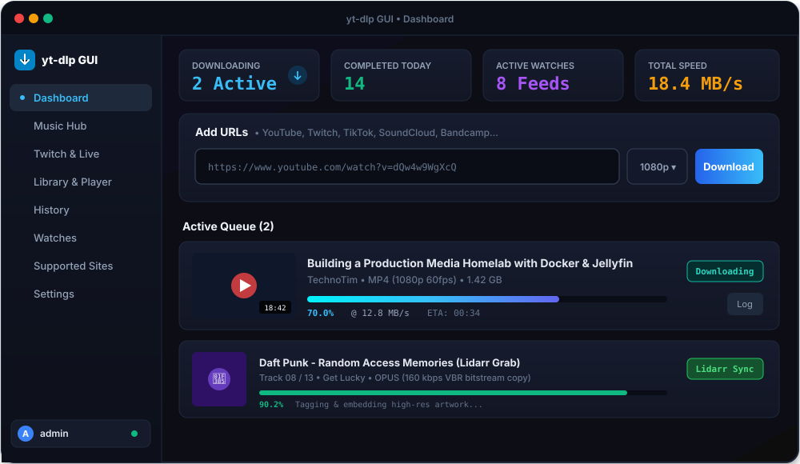
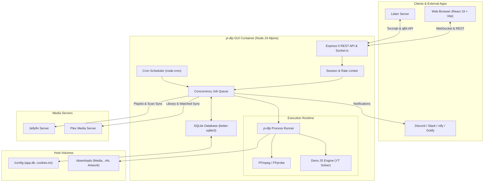
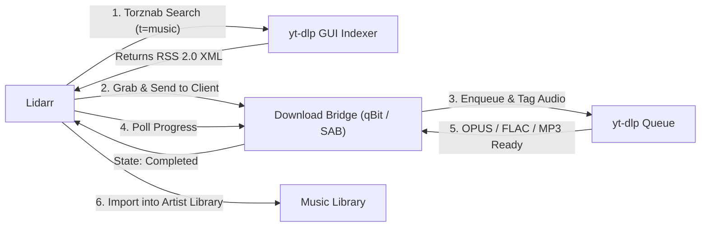

<p align="center">
  <a href="#yt-dlp-gui">
    
  </a>
</p>

<p align="center">
  <a href="https://github.com/rpeters1430/yt-dlp-gui/actions/workflows/docker-publish.yml"></a>
  
  
  
  
  
  
</p>

<p align="center">
  A self-hosted web app for downloading video and audio from <b>any site <a href="https://github.com/yt-dlp/yt-dlp">yt-dlp</a> supports</b> — YouTube, Vimeo, Twitter/X, TikTok, Reddit, SoundCloud, Twitch, Bandcamp, and hundreds more.
  <br>
  Paste URLs, monitor real-time WebSocket progress, manage an in-browser media library, record live streams, organize high-fidelity music releases, and automatically follow channel uploads and playlists.
</p>

<p align="center">
  <a href="#quick-start-docker-compose"><b>🚀 Quick Start</b></a> •
  <a href="#project-status--roadmap"><b>📊 Project Status</b></a> •
  <a href="#features"><b>✨ Features</b></a> •
  <a href="#music-hub--lidarr-integration"><b>🎵 Music & Lidarr</b></a> •
  <a href="#live-streams--twitch-hub"><b>🔴 Live Streams</b></a> •
  <a href="#architecture"><b>🏗️ Architecture</b></a> •
  <a href="#configuration"><b>⚙️ Config</b></a>
</p>

---

<p align="center">
  
</p>

---

## 📊 Project Status & Roadmap

> [!NOTE]
> **Current Release:** `v1.0.0` (Active Production & Feature Development)  
> Container image builds are automatically published to GitHub Container Registry (`ghcr.io/rpeters1430/yt-dlp-gui:latest`) on every merge to `main`.

### Component Status Matrix

| Module | Status | Highlights |
|---|---|---|
| **Core Queue & Downloader** | 🟢 Production Ready | Concurrent queue, watchdog timers, delta socket logs, audio drift correction |
| **Music Hub & Audio Engine** | 🟢 Production Ready | OPUS bitstream copy (~160kbps), 320k MP3, M4A, FLAC, auto-tagging & cover art |
| **Lidarr Torznab & Download Bridge** | 🟢 Production Ready | Torznab indexer (`/api/lidarr/torznab`), qBit/SAB emulation, missing album browser, auto-import sync |
| **Watches (Channel Feeds)** | 🟢 Production Ready | Multi-tab discovery (Videos, Shorts, Live), baseline checks, regex filtering, retry backoff |
| **Live Stream Recorder** | 🟢 Production Ready | YouTube, Twitch, TikTok Live, MPEG-TS HLS chunking, graceful finalization, manual split |
| **Library & Streaming Player** | 🟢 Production Ready | In-browser seeking with HTTP range requests, `.nfo` & poster generation, file protector |
| **Media Server Integration** | 🟢 Production Ready | Jellyfin playlist sync & watched status, Plex library scans & watched auto-delete |
| **Test & Code Quality** | 🟢 212+ Tests Passing | ESLint clean across client and server, modular Express app (`src/app.js`), lazy-loaded client routes |

### Recent Milestones & Improvements
- **🎵 Full Lidarr Integration**:
  - Implemented Torznab RSS 2.0 indexer (`t=caps`, `t=music`, `t=search`) with audio categories (`3000`, `3010`, `3020`, `3040`).
  - Added qBittorrent v2 and SABnzbd Web API emulation with deterministic infohashes and on-demand `.torrent` generation.
  - Direct UI browsing of Lidarr **Wanted / Missing Albums** with one-click queueing and automated `DownloadedAlbumsScan` triggers.
  - Configurable download paths and cross-platform Docker path normalization.
- **🔴 Resilient Live Stream Handling**:
  - Automatically recognizes when streams finish and gracefully completes finalization without killing active remux processes.
  - User-directed chunk splitting when manually stopping live recordings.
  - Real-time elapsed time counter and pulsing indicator for active streams.
- **⚡ Performance & Socket Optimization**:
  - Progress updates stream full logs only on delta changes (≤1/s per job), drastically reducing network chatter.
  - Server-side history searching, status filtering, and pagination.
  - Client-side code splitting with lazy-loaded page routes (initial JS bundle trimmed down to 393 kB).
- **🔊 Audio & Remux Fixes**:
  - Resolved audio sync drift on variable-framerate streams and complex multi-stream remuxes.
- **🧪 Test Suite & Refactor**:
  - Expanded test suite from 146 to 212+ automated tests covering queue lifecycle, mock yt-dlp execution, auto-delete, sessions, and notification delivery.
  - Modularized `ytdlp.js` into focused modules (`ytdlpPaths.js`, `ytdlpCookies.js`, `ytdlpTools.js`).

### Active Backlog & Next Up
- [ ] Non-Watch failed download retry button (`POST /api/downloads/:id/retry`) and bulk queue actions ("Retry all", "Clear completed").
- [ ] Pause / resume and drag-and-drop queue reordering.
- [ ] Dynamic concurrency control adjustable directly in the Settings UI without restart.
- [ ] Automatic duplicate detection for re-submitted video URLs or IDs.
- [ ] Vitest + React Testing Library frontend test suite.
- [ ] Ultra-compact phone layout audit for 360px–400px viewports.

---

## Contents

- [Features](#features)
  - [Downloading & Queue](#downloading)
  - [Library & Browser Player](#library)
  - [Watches (Auto-download Feeds)](#watches-auto-download-new-uploads)
  - [Auto-delete & Housekeeping](#auto-delete)
  - [Live Streams & Twitch Hub](#live-streams)
  - [Music Hub & Lidarr Integration](#music-hub--music-watcher)
  - [Notifications](#notifications)
  - [Media Server Sync (Jellyfin & Plex)](#jellyfin-playlist-sync)
- [Quick start (Docker Compose)](#quick-start-docker-compose)
- [Updating](#updating)
- [Configuration](#configuration)
- [File naming](#file-naming)
- [Notifications](#notifications)
- [Site cookies](#site-cookies-youtube-twitch-and-others)
- [Jellyfin integration](#jellyfin-integration)
- [Plex integration](#plex-integration)
- [Lidarr integration](#lidarr-integration)
- [Scheduled tasks](#scheduled-tasks)
- [Where your data lives](#where-your-data-lives)
- [Security notes](#security-notes)
- [Troubleshooting](#troubleshooting)
- [Local development](#local-development-without-docker)
- [Architecture](#architecture)
- [Automatic image builds](#automatic-image-builds)

---

## Features

### Downloading
- **Batch processing**: Paste one or dozens of URLs at once; jobs queue with configurable concurrency.
- **Real-time feedback**: Live progress over WebSockets (percentage, speed, ETA, and live logs).
- **Granular control**: Quality selector, audio-only (MP3/OPUS/FLAC/M4A), subtitle downloading, embedded metadata/chapters/artwork, and SponsorBlock removal.
- **Full history & inspection**: Browse completed and failed downloads with thumbnails, local file paths, and exact yt-dlp CLI arguments and stdout logs.
- **Custom naming**: Global or per-Watch file and folder templates (see [File naming](#file-naming)).
- **Media server ready**: Automatically writes Kodi/Jellyfin/Emby `.nfo` files and poster artwork for instant scraper recognition.

### Library
- **In-browser media center**: Browse all downloaded media in a responsive grid with instant search, category filters, and sorting.
- **Direct browser playback**: Stream video and audio files directly in the browser with seeking (HTTP range requests) — no external media server needed.
- **File management**: One-click local device download, file deletion protection, or clean removal (including accompanying `.nfo`, subtitles, and posters).
- **Health tracking**: Automatically detects files moved or deleted outside the application.

### Watches (Auto-download new uploads)
- **Automated polling**: Point a Watch at a playlist or channel URL; it automatically checks for new uploads on a schedule (default: 30 minutes).
- **Channel tab support**: YouTube channel URLs (`youtube.com/@name`) can individually track **Videos**, **Shorts**, and **Live streams**.
- **Smart baselines**: Discovered videos are baselined on creation so you aren't flooded with old uploads, with optional backfill of the latest $N$ uploads (or all existing up to 5,000).
- **Regex title filters**: Include and exclude regular expression matching with in-browser regex testing before saving.
- **Automatic retry with exponential backoff**: Failed items retry up to four times (15m, 1h, 6h) before pausing.
- **Audit ledger**: Comprehensive **Activity** tab displaying the exact scan history and disposition of every cataloged video.

### Auto-delete
- **Smart retention**: Automatically clean up watched media after $N$ days, when marked watched in Jellyfin/Plex, or both.
- **Safety controls**: Protect individual videos, exempt specific Watches, and enforce "always keep newest $N$" policies.
- **Nightly execution**: Runs automatically at 03:00 server time, with a manual "Run Now" and dry-run preview.

### Live Streams
- **Universal extractor support**: Seamlessly records YouTube, Twitch, TikTok Live, and any platform supported by yt-dlp.
- **Live edge or full broadcast**: Join at the current moment or record from the start (`--live-from-start`).
- **Upcoming broadcast waiting**: Queue streams before they go live (`--wait-for-video`); recording starts automatically.
- **TikTok & Twitch offline watchers**: Queue **Wait & Auto-Record** on offline channels to start capturing the moment they go live.
- **Interrupt protection**: Captured using MPEG-TS HLS segments (`--hls-use-mpegts`), keeping the output file playable even if unexpectedly stopped.
- **Manual split & graceful stop**: One-click stopping preserves captured video and can split chunks on demand.

### Twitch Hub
- Dedicated interface for monitoring Twitch channels and active recordings.
- Channel VOD browser and downloader.
- Built-in video and clip trimmer with time-range selection.

### Music Hub & Music Watcher
- Search and discover albums, artists, and tracks with high-resolution artwork and 30-second audio previews.
- Auto-match YouTube audio streams and transcode to **OPUS** (highest quality native bitstream copy, ~160 kbps VBR), **MP3** (up to 320 kbps CBR), **M4A (AAC)**, or **FLAC**.
- Full ID3/Vorbis metadata embedding with track numbers and cover art.
- Structured filesystem layout: `{MusicFolder}/{Artist}/{Album}/{TrackNumber} - {Title}.{ext}`.
- Dedicated Music Watches to track artist releases and discographies.

### Lidarr Integration
- **Torznab Indexer (`/api/lidarr/torznab`)**: Emulates a Torznab RSS indexer with full music categories and deterministic torrent infohashes.
- **Download Client Bridge (`/api/lidarr/qbit` & `/api/lidarr/sab`)**: Emulates qBittorrent v2 or SABnzbd API endpoints for seamless handoff to Lidarr's Completed Download Handling.
- **Wanted Albums Browser**: Direct UI interface within the Music page to browse Lidarr's wanted missing albums and grab them with one click.
- **Automatic Library Rescan**: Automatically commands Lidarr to run `DownloadedAlbumsScan` upon job completion.

### Notifications
- Dispatches webhook payloads to **Discord**, **Slack**, **Mattermost**, **Rocket.Chat**, **ntfy**, **Gotify**, or generic JSON webhooks (Home Assistant, n8n, Node-RED).
- Configurable event subscriptions: download completed, download failed, Watch queued new items, or Watch check failures.

### Jellyfin & Plex Integration
- **Jellyfin**: Automated per-Watch playlist creation and synchronization, and "Watched in Jellyfin" auto-delete triggers.
- **Plex**: Post-download library scan commands, per-Watch playlist sync, and token-scoped "Watched in Plex" auto-delete.

### Maintenance & Security
- Bundles self-managed static builds of [yt-dlp](https://github.com/yt-dlp/yt-dlp), [FFmpeg](https://github.com/yt-dlp/FFmpeg-Builds), and [Deno](https://deno.com) (for YouTube challenge solving).
- Toggle between yt-dlp **Stable** and **Nightly** channels with automated overnight update checks.
- Rate-limited single admin authentication with session invalidation on credential rotation.
- Built-in SSRF protection blocking loopback and private IP targeting by default.

---

## System Architecture



---

## Quick start (Docker Compose)

Prebuilt multi-arch images (`linux/amd64` and `linux/arm64`) are automatically pushed to GitHub Container Registry. No local compiling required.

### 1. Create directory structure

```bash
mkdir -p ytdlp-gui/downloads ytdlp-gui/config
cd ytdlp-gui
```

### 2. Create `docker-compose.yml`

```yaml
services:
  ytdlp-gui:
    image: ghcr.io/rpeters1430/yt-dlp-gui:latest
    container_name: ytdlp-gui
    restart: unless-stopped
    ports:
      - "3000:3000"
    env_file:
      - .env
    environment:
      - MAX_CONCURRENT_DOWNLOADS=2
      - TZ=America/Los_Angeles
    volumes:
      - ./downloads:/downloads
      - ./config:/config
```

### 3. Create `.env`

```env
ADMIN_USER=admin
ADMIN_PASSWORD=choose-a-strong-password
```

> [!TIP]
> - If `ADMIN_PASSWORD` is omitted, a random password is generated on first launch and printed once to the container logs (`docker compose logs ytdlp-gui`).
> - Secure this file: run `chmod 600 .env` on Linux servers.

### 4. Start the container

```bash
docker compose pull
docker compose up -d
```

Access the web interface at `http://<your-server-ip>:3000`.

---

## Configuration

All configuration variables can be passed via `.env` or the `environment:` block in `docker-compose.yml`.

### Core Settings

| Variable | Default | Description |
|---|---|---|
| `ADMIN_USER` | `admin` | Administrator username. |
| `ADMIN_PASSWORD` | *(random)* | Administrator password (printed to logs if not set). |
| `SESSION_SECRET` | *(persisted)* | Key used to sign session cookies (stored in `app.db`). |
| `TZ` | `UTC` | Server timezone for schedules and timestamps. |
| `PORT` | `3000` | HTTP port inside the container. |
| `MAX_CONCURRENT_DOWNLOADS` | `2` | Number of simultaneous downloads. |
| `TRUST_PROXY` | `0` | Set to `1` when behind an SSL reverse proxy (Nginx, Caddy, Traefik). |
| `COOKIE_SECURE` | `0` | Set to `1` to restrict session cookies to HTTPS only. |
| `ALLOW_LOCAL_URLS` | `0` | Set to `1` to bypass SSRF guards for private LAN addresses. |

### Watchdogs & Idle Timeouts

| Variable | Default | Description |
|---|---|---|
| `DOWNLOAD_IDLE_TIMEOUT_MS` | `900000` (15m) | Terminate download if yt-dlp yields no output for this duration. |
| `LIVE_DOWNLOAD_IDLE_TIMEOUT_MS` | `3600000` (1h) | Watchdog silence threshold for active live streams. |
| `PLAYLIST_DOWNLOAD_IDLE_TIMEOUT_MS` | `3600000` (1h) | Watchdog silence threshold for large playlist queries. |
| `DOWNLOAD_MAX_QUIET_MS` | `14400000` (4h) | Hard maximum silence ceiling even if CPU activity is detected. |
| `GETINFO_TIMEOUT_MS` | `120000` (2m) | Timeout for metadata probes and Watch check sweeps. |

### Update Schedules (Cron)

| Variable | Default | Description |
|---|---|---|
| `YTDLP_UPDATE_CRON` | `0 3 * * *` | yt-dlp nightly channel check. |
| `FFMPEG_UPDATE_CRON` | `30 3 * * *` | Static FFmpeg build update check. |
| `DENO_UPDATE_CRON` | `45 3 * * *` | Deno JavaScript engine check. |

---

## File Naming

Control download destinations in **Settings → File naming** using [yt-dlp output template syntax](https://github.com/yt-dlp/yt-dlp#output-template).

| Preset | Resulting Path Format |
|---|---|
| **Channel folder** *(default)* | `Example Channel/Video title [id].mp4` |
| **Flat** | `Video title [id].mp4` |
| **Channel / Year** | `Example Channel/2026/Video title [id].mp4` |
| **Channel / Date-prefixed** | `Example Channel/2026-09-14 Video title [id].mp4` |
| **TV show structure** | `Example Channel/Season 2026/S2026E0914 - Video title [id].mp4` |
| **Site / Channel** | `Youtube/Example Channel/Video title [id].mp4` |

> [!TIP]
> The **TV show structure** preset generates `Season YYYY` folders with episode dates, producing complete Kodi/Jellyfin/Plex-compatible series metadata with `tvshow.nfo`, `poster.jpg`, and `fanart.jpg`.

---

## Lidarr Integration

The application functions as a complete bridge between [Lidarr](https://lidarr.audio) and web audio sources.



### Setup Instructions

1. **Torznab Indexer**:
   - In Lidarr, navigate to **Settings → Indexers → Add (+) → Torznab (Custom)**.
   - **URL**: `http://<server-ip>:3000/api/lidarr/torznab`
   - **API Key**: Found under **Music → Lidarr** tab in the web interface.
   - **Categories**: `3000, 3010, 3020, 3040`.
2. **Download Client**:
   - In Lidarr, go to **Settings → Download Clients → Add (+) → qBittorrent**.
   - **Host**: `<server-ip>`
   - **Port**: `3000`
   - **URL Base**: `/api/lidarr/qbit`
3. For in-depth remote path mapping tips and troubleshooting, refer to [docs/lidarr-integration.md](docs/lidarr-integration.md).

---

## Media Server Integration (Jellyfin & Plex)

### Jellyfin
- **Playlist Synchronization**: Automatically creates and maintains a Jellyfin playlist corresponding to each Watch feed.
- **Watched Auto-Delete**: Marks media eligible for deletion once watched by designated Jellyfin users.
- Matching is performed on filenames, ensuring compatibility even when directory mount points differ.

### Plex
- **Immediate Library Scan**: Triggers an on-demand Plex library refresh right after a file completes downloading.
- **Playlist Sync**: Keeps per-channel Plex playlists synchronized with completed downloads.
- **Watched Status Checking**: Polls the authenticated user account to safely trigger cleanup rules.

---

## Local Development (without Docker)

**Prerequisites:** Node.js 24+, `yt-dlp`, `ffmpeg`, and `deno` available on `PATH`.

```bash
# Terminal 1: Backend API (http://localhost:3000)
cd server
npm install
npm run dev

# Terminal 2: Vite React Frontend (http://localhost:5173)
cd client
npm install
npm run dev
```

Run test suite:

```bash
cd server
npm run test
npm run test:coverage
```

Run linter:

```bash
# Server lint
cd server && npm run lint

# Client lint
cd client && npm run lint
```

---

## Troubleshooting

<details>
<summary><b>YouTube "Sign in to confirm you're not a bot" or age-restricted videos</b></summary>

Export your browser session cookies using an extension like *Get cookies.txt LOCALLY* and paste them into **Settings → Site Cookies**. Switch your yt-dlp channel to **Nightly** in Settings if YouTube has rolled out breaking layout adjustments.
</details>

<details>
<summary><b>Progress bars do not move</b></summary>

Your reverse proxy is likely dropping WebSocket upgrade headers. Ensure your proxy configuration forwards `Upgrade` and `Connection` headers (in Nginx Proxy Manager, enable the "Websockets Support" toggle).
</details>

<details>
<summary><b>Session cookies fail to persist / immediate logout</b></summary>

Verify that `COOKIE_SECURE=1` is only enabled when accessing over HTTPS, and that `TRUST_PROXY=1` is set when running behind a TLS termination proxy.
</details>

<details>
<summary><b>Local URLs rejected by download form</b></summary>

Set `ALLOW_LOCAL_URLS=1` in your environment to permit downloading from internal private network mirrors (e.g. `192.168.x.x` or `127.0.0.1`).
</details>

---

## Acknowledgements

- [yt-dlp](https://github.com/yt-dlp/yt-dlp) — The powerful media download engine.
- [yt-dlp/FFmpeg-Builds](https://github.com/yt-dlp/FFmpeg-Builds) — Optimized static audio and video toolchains.
- [Deno](https://deno.com) — Modern secure JavaScript runtime for YouTube challenge evaluation.
- [Lucide](https://lucide.dev) — Clean, consistent icons.
