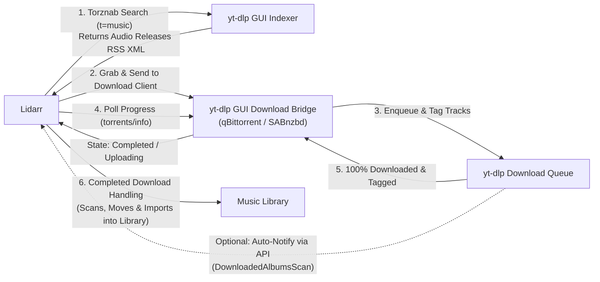

# Lidarr Integration (Indexer & Download Client)

This app can integrate directly with [Lidarr](https://lidarr.audio) to automatically search, download, tag, and import music into your Lidarr library. It acts as both a **Torznab Indexer** and a **Download Client** (via qBittorrent or SABnzbd API emulation).

---

## How It Works

1. **Torznab Indexer (`/api/lidarr/torznab` or `/api/torznab`)**:
   - Supports the standard Torznab specification (`t=caps`, `t=music`, `t=search`).
   - When Lidarr searches for an artist or album, our indexer searches high-fidelity music releases and returns Torznab RSS 2.0 XML with audio categories (`3000`, `3010`, `3020`, `3040`).
   - Generates valid `.torrent` files on demand with deterministic SHA-1 infohashes matching the download client tasks.

2. **Download Client Bridge (`/api/lidarr/qbit` or `/api/lidarr/sab`)**:
   - **qBittorrent Web API emulation**: Emulates qBittorrent v2 Web API (`/api/v2/auth/login`, `/api/v2/app/version`, `/api/v2/torrents/add`, `/api/v2/torrents/info`).
   - When Lidarr sends a download task, all tracks for the release are resolved and enqueued into the download queue with high-bitrate encoding (OPUS, 320k MP3, M4A, FLAC) and embedded metadata and album art.
   - Reports live progress back to Lidarr as tracks complete. Once 100% finished, reports `state: uploading` and the storage path.
   - Lidarr's **Completed Download Handling** detects the completion, inspects the tags, and moves/imports the songs into your artist library.
   - **SABnzbd emulation** is also available at `/api/lidarr/sab` for users who prefer Usenet client configuration in Lidarr.

3. **Lidarr Server REST API Client**:
   - When configured with your Lidarr Server URL and API key, the app can automatically trigger Lidarr's `DownloadedAlbumsScan` command immediately when a music download finishes.
   - You can also view and browse **Wanted / Missing Albums** from Lidarr directly inside the Music page and trigger searches/downloads with one click.

---

## Step-by-Step Configuration

In the app, open the **Music** page and click the **Lidarr** tab. Your unique Torznab API key and copy buttons are displayed there.

### 1. Add Indexer in Lidarr

1. In Lidarr, navigate to **Settings → Indexers**.
2. Click the **+** (Add) button and select **Torznab (Custom)**.
3. Configure the fields:
   - **Name**: `yt-dlp Music`
   - **URL**: `http://<your-server-ip>:3000/api/lidarr/torznab`
   - **API Key**: Copy your generated key from the Lidarr tab in the app.
   - **Categories**: `3000, 3010, 3020, 3040` (Audio).
4. Click **Test** (should show a green checkmark) and then **Save**.

### 2. Add Download Client in Lidarr

1. In Lidarr, navigate to **Settings → Download Clients**.
2. Click the **+** (Add) button and select **qBittorrent**.
3. Configure the fields:
   - **Name**: `yt-dlp GUI`
   - **Host**: `<your-server-ip>`
   - **Port**: `3000` (or your app's port)
   - **URL Base**: `/api/lidarr/qbit`
   - **Username / Password**: Can be left blank or filled with any placeholder text.
   - **Category**: `music`
6. Ensure **Completed Download Handling** is enabled.
7. Click **Test** and then **Save**.

### Remote Path Mappings (Docker / Alpine)

The download client reports the download save path as an absolute Linux path (`/downloads/Music`), satisfying Linux and Alpine container path validation. If your Lidarr container has the shared download volume mounted at a different mount point (e.g. `/music` or `/data/downloads`), configure a Remote Path Mapping in Lidarr:

1. In Lidarr, navigate to **Settings → Download Clients**.
2. Scroll down to **Remote Path Mappings** and click **+** (Add).
3. Set:
   - **Host**: `<your-server-ip>` (e.g. `192.168.50.114`, matching the Host entered in your Download Client)
   - **Remote Path**: `/downloads/Music`
   - **Local Path**: The path inside Lidarr's container where the downloaded music files appear (e.g. `/music` or `/data/downloads`)
4. Click **Save**.

*(Optional: If you prefer SABnzbd, choose SABnzbd in Lidarr, set Host and Port to your server, URL Base to `/api/lidarr/sab`, and API Key to your Torznab API Key).*

### 3. Connect Lidarr in yt-dlp GUI (Optional but Recommended)

In the app's **Music → Lidarr** tab:
1. Enter your **Lidarr Server URL** (e.g. `http://localhost:8686`).
2. Enter your **Lidarr API Key** (found in Lidarr: **Settings → General → Security → API Key**).
3. Enable **Automatically notify Lidarr when downloads finish**.
4. Click **Test Connection** and then **Save Lidarr Settings**.
5. You can now view missing/wanted albums from your Lidarr library directly within the app and queue them with one click!
